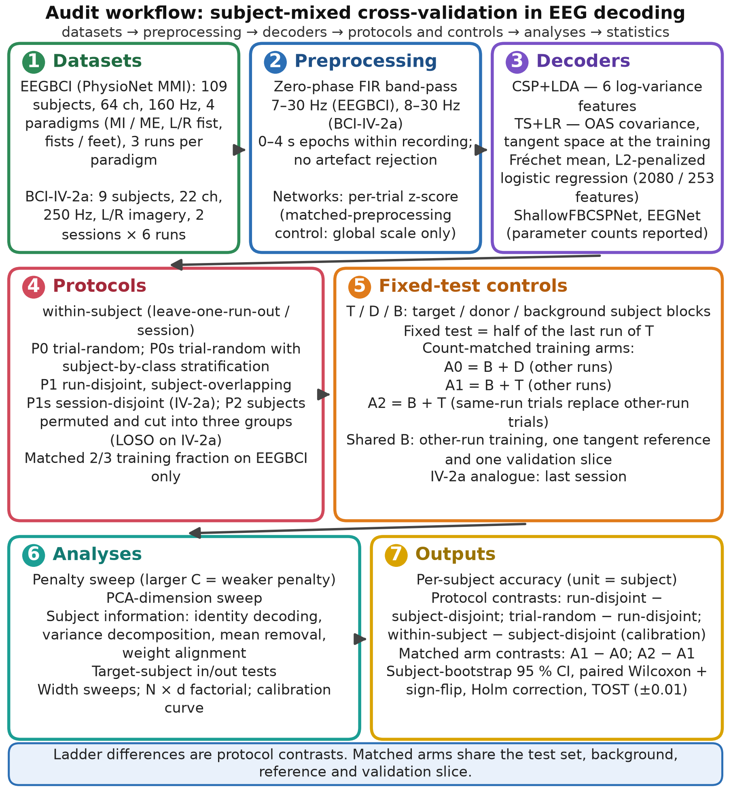

# Subject overlap in subject-mixed cross-validation of EEG sensorimotor decoders



A hierarchical split audit of subject-mixed cross-validation on two public EEG sensorimotor datasets, with matched controls (revision 2)
(PhysioNet motor movement/imagery, 109 subjects; BCI Competition IV-2a, 9 subjects) with four decoders
(CSP+LDA, Riemannian tangent space + logistic regression, ShallowFBCSPNet, EEGNet). The splits differ in which
recording units may straddle the train/test boundary — trial-random (P0), run-disjoint but subject-overlapping
(P1), session-disjoint (P1s, IV-2a) and subject-disjoint (P2; leave-one-subject-out on IV-2a) — at matched
training fractions with repeated partitions. The ladder's pairwise differences are protocol contrasts:
Δ(P1 − P2) is the **subject-overlap contrast** and Δ(P0 − P1) is the **trial-random − run-disjoint (protocol contrast)**,
neither an isolated mechanism (see Revision 2 below). Controlled analyses of the tangent-space pipeline ask where the
subject information lives.

This release (`revision-v3`) adds the second-revision analyses (tag `rev2`, frozen plan `research/REVISION_PLAN_v2.md`) to the first-revision suite (`rev1`, plan v1); both supersede the July 2026 analysis (kept under `test/experiments/eegbci_full`,
`test/experiments/bci2a`, `results/eegbci_full`, `results/bci2a`). Two July statements are withdrawn by the new
controls: regularization does **not** remove the subject-overlap contrast (it shrank only where subject-disjoint accuracy also fell, consistent with underfitting),
and the convolutional networks are **not** unaffected (they show a contrast of about 0.02 on EEGBCI and
0.06–0.09 on IV-2a).

## Plain-language summary

If trials of the same person are on both sides of a cross-validation split, a decoder can look better than it
will be on a new person. We measured how much of that inflation is really due to the person being on both sides,
as opposed to neighbouring trials of the same run or session. On 109 subjects, letting subjects straddle the split
while keeping runs disjoint inflated the tangent-space pipeline by 0.068 accuracy, the two networks by about
0.02 and CSP+LDA by 0.009, whereas the trial-random minus run-disjoint protocol contrast was at most +0.008 by its upper confidence limits — a protocol contrast that does not bound run adjacency; at matched training composition, same-run adjacency added +0.016 [+0.009, +0.023] for TS+LR. The
tangent-space features identify the subject perfectly (86 % of their variance is between subjects); centring each
subject on its own mean (a transductive transformation) reduced the inflation by about 70 % and raised cross-subject
accuracy by 0.08, but the mechanism behind the remainder is unresolved. Stronger regularization does not help;
subject-disjoint evaluation remains necessary.

## Key numbers (unit = subject; EEGBCI = mean over four paradigms, n = 109; 95 % subject-bootstrap CIs; source files in `results/revision/`)

| Decoder | P0 trial-random | P1 run-disjoint | P2 subject-disjoint | Δ(P1 − P2) subject overlap | Δ(P0 − P1) trial-random − run-disjoint (protocol contrast) |
|---|---|---|---|---|---|
| CSP+LDA | 0.554 | 0.579 | 0.570 | +0.009 [+0.003, +0.015] | −0.025 [−0.031, −0.018] |
| TS+LR | 0.685 | 0.688 | 0.620 | +0.068 [+0.058, +0.077] | −0.003 [−0.008, +0.002] |
| ShallowFBCSPNet | 0.710 | 0.710 | 0.688 | +0.022 [+0.017, +0.027] | 0.000 [−0.005, +0.004] |
| EEGNet | 0.754 | 0.750 | 0.726 | +0.024 [+0.018, +0.030] | +0.004 [0.000, +0.008] |

Paired two-sided Wilcoxon signed-rank tests over the 109 subjects (differences rounded to 12 decimals before ranking),
Holm-corrected over the 12 contrasts of the displayed table (`stats_rev1_contrasts.csv`, columns `family`, `family_size`,
`p_holm`): subject-overlap contrasts p_Holm ≤ 2.2 × 10⁻¹⁰ for TS+LR and the two networks, p_Holm = 0.031 for CSP+LDA.

Revision 2 matched controls (fixed half-last-run test; matched training composition; common background reference and validation slice; `stats_rev2_matched.csv`, EEGBCI `paradigm_mean`, `bg_fixed`):

| Decoder | Δ_incl (A1 − A0) | Δ_adj (A2 − A1) |
|---|---|---|
| CSP+LDA | +0.004 [−0.004, +0.012] | +0.004 [−0.001, +0.011] |
| TS+LR | +0.073 [+0.061, +0.085] | +0.016 [+0.009, +0.023] |
| ShallowFBCSPNet | +0.021 [+0.009, +0.032] | −0.001 [−0.009, +0.008] |
| EEGNet | +0.037 [+0.027, +0.046] | −0.007 [−0.016, +0.003] |

Δ_incl replaces count-matched donor trials with the test subjects' other-run trials; Δ_adj replaces other-run with same-run trials of those subjects. These contrasts describe this fixed-test design.

BCI-IV-2a (n = 9, leave-one-subject-out; `stats_rev1_contrasts.csv`): run-disjoint − LOSO = +0.098 (TS+LR),
+0.051 (CSP+LDA), +0.060 (ShallowFBCSPNet), +0.094 (EEGNet); session-disjoint − LOSO = +0.036 / +0.025 /
+0.021 / +0.059 (exact conditional signed-rank test; the smallest attainable raw p is 0.0039 at n = 9, and with 24
contrasts in the displayed table no Holm-adjusted value can fall below 0.0938 (24 × 2/2⁹), so the statements for this dataset rest
on the confidence intervals and sign counts).

Other results (all in `results/revision/stats_rev1_*.csv`): regularization sweep (`e2`), subject-identity
decoding and variance decomposition (`e3a`, `e3b`), subject-mean removal and Riemannian recentering (`e3c`),
weight alignment (`e3d`), PCA-dimension sweep (`e4`), six classifiers on identical features (`e5`), reference-mean
tests with TOST (`e6`, `e14`), width sweeps (`e9_*width*`), training-subject count × dimension factorial (`e8`),
within-subject networks (`e11`), calibration-size curve (`e12`: up to thirty labelled trials raise TS+LR by +0.070, show no detected difference for CSP+LDA, and do not improve EEGNet under fixed fine-tuning), matched preprocessing (`e1_*ztrial*`,
`e9_*global*`), exploratory stratification analysis (`e15`).

`results/revision/SOURCES.md` maps every table and claim to its source file; earlier partial exports are kept privately; the public tree ships only the current exports.

## Revision 2 (tag `rev2`): corrected factorial, matched controls, identity probe

- **Protocol contrasts.** Every pairwise difference of the split ladder is a *protocol contrast*: it compares two evaluation procedures that differ in the named recording unit and in other respects at the same time (training composition; the class-proportion property of globally stratified trial-random folds), so a small contrast does not bound a mechanism. The ladder numbers above are unchanged.
- **Factorial correction** (`e8_factorial.py`, `e8_rev2_*`): the first-revision script skipped a PCA dimension per fold when it exceeded that fold's training size but left the skipped fold's trials marked as misclassified; exactly one released condition was affected (real_fists_feet, N = 18, d = 512, draw 6). Feasibility is now decided over all six folds of both protocols before a condition is scored, with a coverage assertion and regression tests (`tests/test_e8_feasibility.py`); `e8_rev2_feasibility.csv` lists the 41 infeasible conditions. The rerun reproduces all 1886 retained cells of `e8_rev1_per_draw.csv` exactly (`tests/compare_e8_rev1_rev2.py`); the dimension and subject-count conclusions are unchanged (`stats_rev2_factorial.csv`).
- **Matched controls** (`e1_ladder_classical.py --protocols trial_random_sc`, `e17_fixed_test.py`, `e9_deep_ladder.py --fixed-test`, `e10_bci2a_deep.py --fixed-test`, `e_stats_r2.py`; `stats_rev2_matched.csv`): (a) a subject-by-class-stratified trial-random split P0s (each subject's training and test class proportions agree to within one trial per class); (b) a fixed-test framework whose count-matched training arms share a background block of other subjects, one tangent reference and one validation slice and differ only in whether the test subjects' other-run trials replace count-matched donor trials (target inclusion, Δ_incl = A1 − A0) or same-run trials replace other-run trials of the same subjects (same-run adjacency, Δ_adj = A2 − A1); the test set is half of the last run of a 36-subject target block. EEGBCI (n = 109; Holm over the 12 contrasts of the displayed table): Δ_incl = +0.073 [+0.061, +0.085] (TS+LR), +0.037 (EEGNet), +0.021 (ShallowFBCSPNet), +0.004 [−0.004, +0.012] (CSP+LDA); Δ_adj = +0.016 [+0.009, +0.023] (TS+LR) and within the CI of zero for the other three; Δ(P0s − P1) between −0.008 and +0.006; Δ(P0 − P0s) negative for the classical decoders (−0.017, −0.008). BCI-IV-2a (n = 9, descriptive): Δ_incl +0.038 to +0.076 for all four; same-session adjacency +0.059 for TS+LR (not smaller than its inclusion contrast), ≤ +0.019 for the others.
- **Identity probe with an independent centring reference** (`e3v2_subject_info.py`; `e3a2_rev2*`): the first-revision all-trial centring forces each subject's centred training and test means to sum to zero, so its near-zero identity accuracy reflects the construction. With the centring vector estimated from a separate reference run, a probe trained on one run identifies the subject in another at 0.68–0.70 (macro over 109 subjects; chance 0.009); with disjoint halves of the reference run centring training and test features, 0.50–0.56; the difference (0.13–0.19) is the signal a shared estimated centring vector introduces. It changes two things at once, whether the centring vector is shared between training and test and how many trials estimate each vector (a whole run versus half a run), under the assumption that the trials of a run are independent given the subject; it is a diagnostic contrast, not an isolated attribution. Training-run centring gives chance. The recording order of each run is recovered from the EDF annotations (the caches store trials class-blocked) and released in the manifest.
- **Sequential variance decomposition** (`e3b2_rev2.csv`): Type I sums of squares in two orders — subject 0.86–0.87, class given subject 0.0002–0.0004, subject × class 0.003–0.007, residual 0.13–0.14 — equal to the first-revision marginal values to three decimals.
- **Provenance.** `research/REVISION_PLAN_v2.md` (frozen 2026-10-30 before any rev2 run; `REVISION_PLAN_v2.sha256`), `research/PLAN_V1_TRANSFORMATION_RECORD.md` (why the released copy of plan v1 has a different checksum from the frozen one, with the exact substitution) and `research/DECISION_LOG_public.md` (every decision taken after results were seen).

## Reproduce

```bash
python -m venv .venv && source .venv/bin/activate
pip install numpy scipy scikit-learn mne pyriemann moabb braindecode torch matplotlib joblib
# data (public): EEGBCI 109 subjects via MNE (a PhysioNet S3 mirror is much faster than physionet.org), BCI-IV-2a via MOABB
python test/experiments/eegbci_full/eegbci_full_dataset_prepare.py
python test/experiments/bci2a/bci2a_dataset_prepare.py
# the revision suite (see research/REVISION_PLAN_v1.md for the frozen definitions and decision rules)
bash test/experiments/revision/run_all.sh rev1          # one CPU chain + one chain per GPU; ~3 h on 48 cores + 4 L40S
python test/experiments/revision/e_stats.py --tag rev1 ... # statistics tables (arguments listed in the script header)
python test/experiments/revision/fig2_ladder.py --e1 ... # one script per figure
# revision 2 (plan v2): corrected factorial, identity probe v2, matched controls (launch lines in test/env/launch_*_rev2.sh)
bash test/env/launch_e8_rev2.sh; bash test/env/launch_e3v2_rev2.sh; bash test/env/launch_matched_rev2.sh
python test/experiments/revision/e_stats.py --tag rev2 --e8 results/revision/e8_rev2_per_draw.csv
python test/experiments/revision/e_stats_r2.py --tag rev2 && python test/experiments/revision/tables_r2_matched.py --tag rev2
python -m unittest discover -s test/experiments/revision/tests -p 'test_*.py'   # regression tests incl. the factorial feasibility rule
```

Every run writes a JSON manifest (command, seeds, package versions, code revision, output hashes) next to its
CSVs. Seeds: 20260916 (+0–4 for repeated partitions), 20260916–20260918 for network training.

## Limitations

Two public two-class sensorimotor corpora; one training recipe for the networks; width sweeps and the
calibration curve with one seed; the residual subject-overlap contrast after subject-mean removal (about 0.02)
is not explained by the diagnostics here; the matched controls use one test run, one two-run training composition and the 109-subject corpus (the nine-subject between-session analogue is descriptive and does not rank inclusion against adjacency); the exploratory stratification analysis was added after the ladder
results were seen.

## Layout

```
test/experiments/revision/   # common.py, deep_common.py, e1..e15 experiment scripts, e_stats.py, make_tables.py, fig*.py, run_all.sh
results/revision/            # per-subject / per-fold / per-draw result tables (tag rev1) + manifests + stats tables + SOURCES.md
result/figure/revision/      # figures (PNG, 300 dpi) with generated captions
research/REVISION_PLAN_v1.md # frozen analysis plan of revision 1 (sha256 in REVISION_PLAN_v1.sha256; PLAN_V1_TRANSFORMATION_RECORD.md explains the released copy's checksum)
research/REVISION_PLAN_v2.md # frozen plan of revision 2 (byte-identical to the frozen file; REVISION_PLAN_v2.sha256)
research/DECISION_LOG_public.md # decisions taken after results were seen (revisions 1 and 2)
test/experiments/revision/tests/ # regression tests (factorial feasibility, identity probe fixtures, matched-control construction)
test/env/                    # venv rebuild, data fetch and launch scripts
test/experiments/eegbci_full, test/experiments/bci2a, results/eegbci_full, results/bci2a   # July 2026 analysis (superseded)
```

License: MIT (Copyright (c) 2026 Woncheol Jeong).
